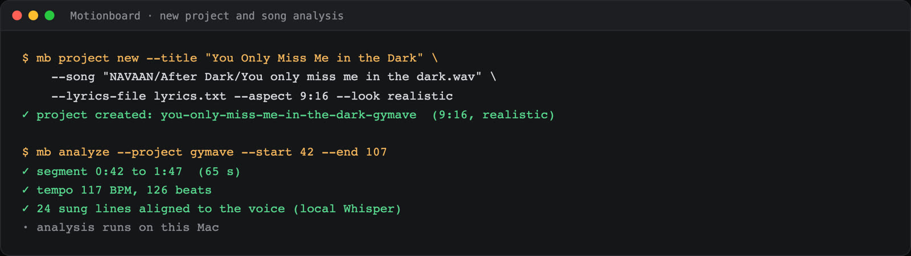
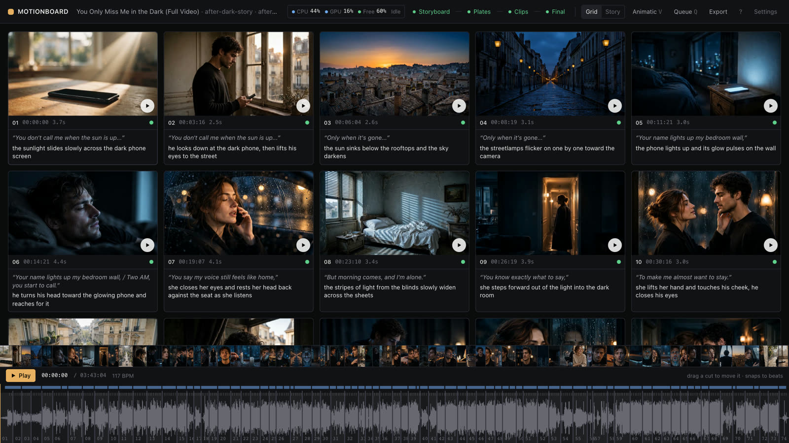
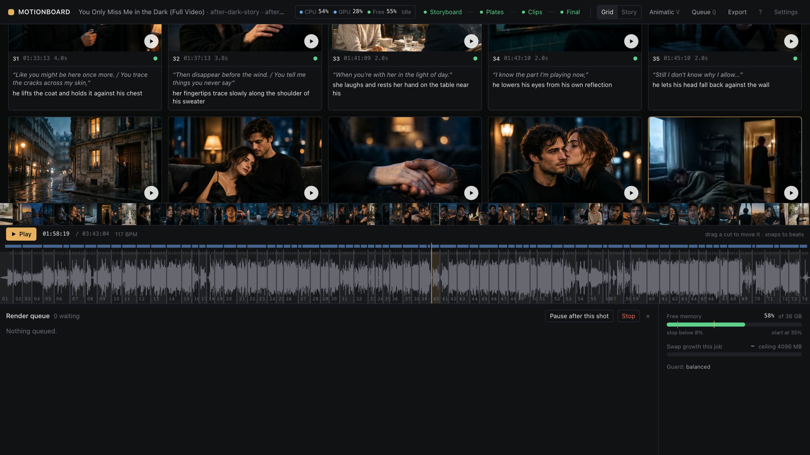

# Motionboard

Storyboard first video, made on your own Mac. Free, open video models: no credits, no subscription, no limit on takes.

https://github.com/user-attachments/assets/d171b3b7-4e39-4a7e-8ed2-088020a57247

Higher quality: [docs/media/motionboard-overview.mp4](docs/media/motionboard-overview.mp4)

Motionboard is an open source Claude plugin. Give it a song, lyrics and an idea. It helps you write a director's treatment and a storyboard timed to the music, makes an image plate per shot from whatever image source you use, animates each shot locally with a free, open video model (LTX-2.3 by default, LTX-2.5 for lip sync), and finishes the cut with lyrics, grade and an end card. A local Storyboard Studio web app shows the whole board, every take, the render queue and your memory use.

A song is one way in. The same steps make music videos, vertical reels, lyric videos and promos.

> Status: early. The engine, skills, Studio and mode packs work end to end on the reference Mac (M3 Max, 36 GB). The overview shows a real 3:47 music video, its 9:16 reel and a lyric story made with it.

## Free to learn

The video models run on your Mac, so a take costs nothing. Render, redo and try another direction as often as you like: it is a place to practise directing and editing without paying per try.

- **Video:** LTX-2.3 and LTX-2.5 run locally. Their weights are free to download; LTX-2.3 is free for individuals and companies under USD 10M annual revenue ([licences](docs/licenses.md)).
- **Images:** use your own pictures or a local image model and the whole video costs $0. A paid image tool (about 1 cent an image) is optional, and Motionboard always asks before spending.
- **Machine:** the memory guard pauses a render before your Mac runs out of memory.

## How it works

| | |
|---|---|
|  | **1. Listen.** `mb analyze` finds the tempo, the beats and every sung line on your machine. |
|  | **2. Storyboard.** A one page treatment first: what the song means, not what it names. Then one shot per beat of the story. Nothing renders until you approve it. |
|  | **3. Images.** One plate per shot from your own files, a local model, an HTTP API or an MCP image tool. Characters keep the same face. |
|  | **4. Takes.** Each shot is animated locally. Every take is kept; the take in use only changes when you pick one. Takes that jump scene are flagged before you watch. |
|  | **5. The cut.** Play the board against the song, move a cut to a beat, redo any shot. |
|  | **6. Render safely.** One shot at a time under a memory and swap guard you control. Then `mb finish` adds lyrics, grade, credits and a cover. |

The people in the overview and screenshots are AI-generated characters.

## Install

```bash
git clone https://github.com/navjyotnishant/motionboard ~/motionboard
cd ~/motionboard && ./install.sh
```

The installer checks your Mac, installs the engine, the `mb` command, the Studio and the Claude Code plugin, and
asks before downloading anything large. Full guide, update and uninstall: [docs/install.md](docs/install.md).

**Claude app (desktop or mobile):** upload [`dist/motionboard.plugin`](dist/motionboard.plugin) in claude.ai plugin
settings. The skills then run `mb` on your Mac through the Claude desktop app link. Rebuild it with
`scripts/package-plugin.sh` after changing the skills.

## Principles

- **Storyboard first.** Nothing renders until you approve the board.
- **Free and local by default.** Video models run on your Mac. Paid services are optional and always ask first.
- **Never crash the machine.** Every heavy job runs under a memory and swap guard you control.
- **No bundled weights.** You download models yourself and accept their licenses.
- **Runs on localhost only.** No account, no hosted site.

Full rules: [.specify/memory/constitution.md](.specify/memory/constitution.md).

## Skills

| Skill | What it does |
|---|---|
| `mb-setup` | Checks your machine, tools and models; prints exact steps for anything missing |
| `mb-storyboard` | Brainstorm or mode plus look, director's treatment, timed shot list, characters, contact sheet, approval |
| `mb-clips` | Image plates per shot from any source, local video clips and lip sync under the memory guard, take checks |
| `mb-finish` | Animation pack, lyrics, grade, end card, cover, metadata, delivery folder |

Each skill drives the `mb` CLI. Every command takes `--json` and prints one report.

Checks the tool runs for you: a clip that jumps scene part way through, a sung line the singer holds only in part, and a shot that repeats its lyric word for word. Lip-sync shots can mute a backing echo with `mb clips --sing-until`.

## Modes

| Mode | Story | Signature animation |
|---|---|---|
| Two Lovers | a couple across scenes | ruby thread, fairy dust lyrics |
| Studio Session | the singer in a recording booth, chorus lip-sync | REC light, VU meters, typed lyric sheet, cassette card |
| Travel | a journey, one place per section | route line, ink stamp lyrics, boarding pass |
| Lyric Story | one scene per sung line | one big word per beat, handwriting |
| Mood Loop | slow ambient shots | light leaks, drifting motes, breathing lyrics |

Looks: origami, exotic, vintage film, neon night, cosmic.

## Docs

[Install](docs/install.md) · [First video](docs/first-video.md) · [Plate adapters](docs/adapters.md) · [Memory guard](docs/guard.md) · [Licences](docs/licenses.md)

## Requirements

- Apple Silicon Mac, macOS 14+, 32 GB memory or more (Linux works except the MLX video backend)
- uv, ffmpeg 7+, Node 20+
- Claude Code

## Layout

```text
.claude-plugin/   plugin manifest
skills/           plugin commands
engine/           Python engine, `mb` CLI
studio/           local Next.js Storyboard Studio
video/            Remotion source of the product overview
modes/            story modes and their signature animation packs
looks/            looks (style lines)
specs/            Spec Kit specs, plans and tasks
```

## Licence

- Engine, Studio and plugin glue: MIT ([LICENSE](LICENSE)).
- Mode animation packs (`modes/*/animation/`): PolyForm Noncommercial 1.0.0. Free to use for your own videos and to study or change; not for commercial reuse or resale of the packs themselves. Videos you make with them are yours.
- Model weights you download keep their own licences.
