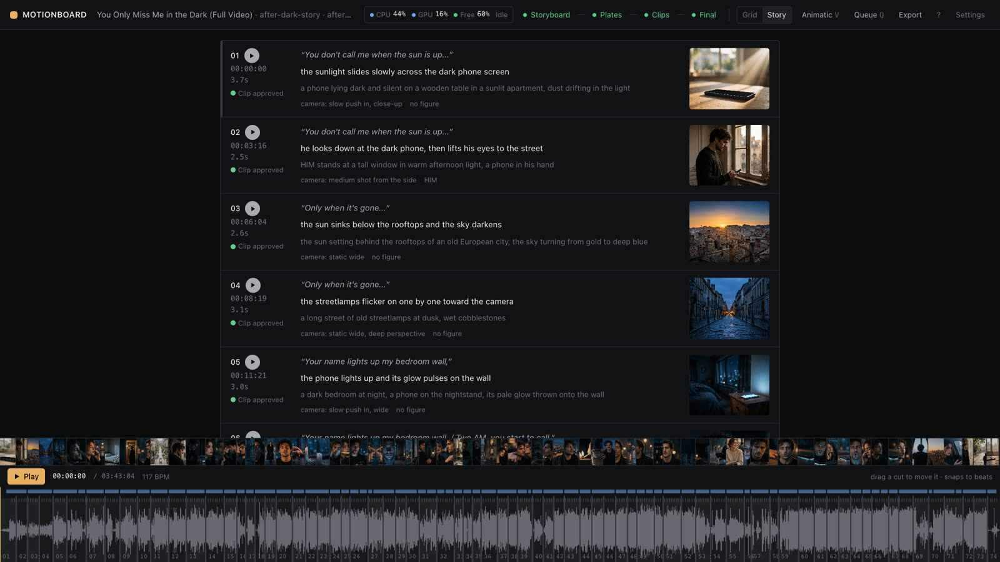
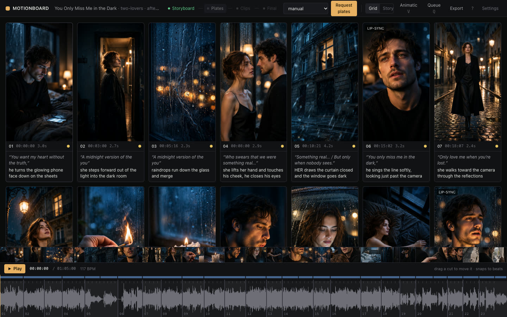
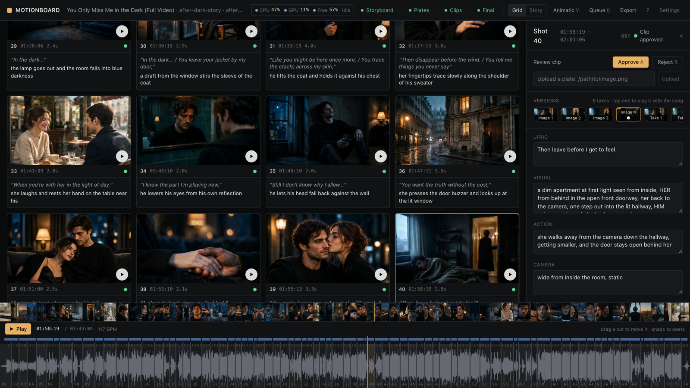

# Motionboard

**Storyboard first video, made on your own Mac. Free, open video models: no credits, no subscription, no limit on takes.**

[](LICENSE)
[](modes/LICENSE)


[Start here](#start-here) · [Why](#why-motionboard) · [How it works](#how-it-works) · [Proof](#proof-the-first-real-productions) · [Free to learn](#free-to-learn) · [Install](#install) · [Docs](#docs)

https://github.com/user-attachments/assets/d171b3b7-4e39-4a7e-8ed2-088020a57247

Higher quality: [docs/media/motionboard-overview.mp4](docs/media/motionboard-overview.mp4)

Motionboard is an open source video production tool that runs entirely on your Mac. You bring an idea and, if you have one, a song. Motionboard takes it through the stages a real crew would: a story and the feeling under it, the music, a director's treatment, the film's art direction, a storyboard timed to the beat, an image for every shot, locally rendered clips and lip sync, review of every take, and a finished cut with lyrics, grade, end card and cover.

It is a tool first: a command line engine (`mb`), a local web app (the Storyboard Studio) and a local database. A Claude plugin is available for it too, with one skill per crew role, so you can direct the whole production in plain language from Claude Code or the Claude app.

A song is one way in. The same steps make full music videos, vertical reels, lyric videos and promos.

> **Status:** early (v0.6.1). The engine, Studio, crew skills and five mode packs work end to end on the reference Mac (M3 Max, 36 GB). Three real productions are shown under [Proof](#proof-the-first-real-productions).

---

## Start here

| You are | Do this |
|---|---|
| Using **Claude Code** | Install (below), restart Claude Code, then say "make a music video for this song" or "write a promo for my product". The crew skills take it from there. |
| Using the **Claude app** (desktop or mobile) | Install on your Mac, then add [`dist/motionboard.plugin`](dist/motionboard.plugin) in claude.ai plugin settings. The skills run `mb` on your Mac through the Claude desktop app link. |
| Working **without Claude** | Use `mb` and the Studio directly. Every command takes `--json` and prints one report. See [docs/first-video.md](docs/first-video.md). |

```bash
git clone https://github.com/navjyotnishant/motionboard   # in the folder where you keep code
cd motionboard && ./install.sh
mb setup          # ready_for_clips: True means you can render
mb studio start   # opens the Storyboard Studio on localhost
```

---

## Why Motionboard

### Where the idea came from

Motionboard started on 23 November 2026 with one reel. [NAVAAN](https://navaan.online), an independent music project, needed a 65 second vertical video for "Almost Yours", a song from the album *After Dark*. The concept was *The Museum of Almosts*: origami lovers moving through glass cases, tied by a ruby thread.

The first attempts showed the problem clearly:

- **The storyboard lived in one tool** (Boords), the images came from another, and the song's beats and line timings lived in separate scripts. Nothing knew about anything else.
- **A code-built 3D version** of the waltz scene looked like "a puppet dance, not clean work".
- **Cloud video generators** charge for every generation, and a music video needs many takes of every shot before one is right. Experimenting gets expensive fast.

Then a local test with the open LTX-2 video model on the Mac produced a waltz that was "pretty cool", and a second take with hand gestures written into the prompt was "perfect". All 23 shots were rendered locally, finished with fairy-dust lyric typography and a closing card, and delivered for posting. The video model cost nothing to run.

That workflow (a storyboard first, one image per shot, local animation, a finishing pass) worked well enough to deserve being a tool. Motionboard was set up the next day.

### What it solves

| The problem | What Motionboard does |
|---|---|
| Every AI video take costs credits, so people stop experimenting | Video models run locally: a take costs $0, so you can redo a shot as often as it takes |
| AI video tools generate clips, not films: no story, no timing, no continuity | A storyboard timed to the song comes first, and nothing renders until you approve it |
| Generated music videos illustrate the lyrics word for word, so they feel flat | A director's treatment interprets the song (what it means, not what it names), and a check flags literal shots |
| Faces and places drift from shot to shot | One image plate per shot with character references, then animation from that exact frame |
| Lip sync falls apart, or a singer mouths words that are not his | Lip-sync shots render from the voice itself (LTX-2.5), and the board keeps every sung line on one singer |
| A long render freezes the laptop | Every render runs under a memory and swap guard that stops it before the machine runs out |
| Bad takes are found only after a night of rendering | Test shots first, and every finished take is checked for scene jumps before anyone watches |
| Storyboard, takes, cut and finish live in five different apps | One project, one local database, one board you can play against the song |

---

## How it works

Motionboard works like a small film crew. Each role is a skill in the plugin and a set of `mb` commands in the engine, and each hands over to the next:

```text
  idea, song (optional)
           │
           ▼
  ┌─────────────────┐   ┌─────────────────┐   ┌─────────────────┐   ┌─────────────────┐   ┌─────────────────┐   ┌─────────────────┐
  │ Writer          │ → │ Composer        │ → │ Director        │ → │ Designer        │ → │ Cinematographer │ → │ Editor          │
  │ concepts        │   │ song or         │   │ vision          │   │ world, Art      │   │ plates with all │   │ takes           │
  │ story           │   │ music bed       │   │ treatment       │   │ Direction Bible │   │ references      │   │ cut, motifs     │
  │ lyrics or       │   │ tempo,          │   │ storyboard      │   │ motifs,         │   │ clips, lip sync │   │ finish          │
  │ script          │   │ sung lines      │   │ cast            │   │ motion rules    │   │ memory guard    │   │ deliver         │
  └────────┬────────┘   └─────────────────┘   └────────┬────────┘   └────────┬────────┘   └────────┬────────┘   └────────┬────────┘
           │ emotion.md                                │ you approve         │ you approve         │ you approve         │ you approve
           ▼                                           ▼                     ▼                     ▼                     ▼
                                                  storyboard             the Bible           plates, clips          final video
  ┌──────────────────┐
  │ Emotional editor │ ◄─ reviews the board, the Bible and the cut
  │ subtext, arc     │
  └──────────────────┘
```

| Role | Skill | What it does | Tools it uses |
|---|---|---|---|
| Writer | `mb-writer` | Three distinct concepts, a one page story with a turn, lyrics a singer can sing or a script timed per line | Claude; the optional `lyrics-room` plugin |
| Emotional editor | `mb-emotion-editor` | An independent reading of the song's subtext, emotional arc and visual cliches to avoid; reviews whether the final board creates the intended feeling | Claude |
| Composer | `mb-composer` | Your song untouched, or a song or instrumental bed made free on your Mac; finds tempo, beats, sections and every sung line | ACE-Step 1.5 (optional, local), librosa, mlx-whisper (local), demucs (vocal isolation) |
| Director | `mb-director` | Owns the vision: defends the concept, one page treatment, briefs the designer and reviews the Bible, a storyboard timed to the music, each shot's action, camera and intent, rejects beautiful shots that do not serve the film | `mb draft`, `mb character`, `mb critique`, the Storyboard Studio |
| Production designer | `mb-production-designer` | The film's world as an Art Direction Bible: physical rules, characters as physical constructions, materials and symbolic objects, palette and light, camera language, motifs and how they change, motion grammar, what never changes | `mb art`, the Studio's Art view |
| Cinematographer | `mb-cinematographer` | Reads the approved Bible first; one image plate per shot from any source with every character's references, clips and lip sync rendered locally under the motion grammar, bad takes diagnosed and rendered again | LTX-2.3 and LTX-2.5 (MLX, local), any image source, the memory guard |
| Editor | `mb-editor` | Watches every take, picks the take in use, checks the whole film's progression, motifs and payoff, rough cut, finish with lyrics, signature animation, grade, end card, cover, delivery | ffmpeg, HyperFrames (animation packs), the Storyboard Studio |

Gates keep you in charge: you approve the **storyboard**, the **plates** and the **clips** before the next stage starts, and the **final** video before delivery. A narrative film also has an **Art Direction Bible** you approve before plates; a simple travel or mood video can skip it. Every take is kept; the take a shot uses only changes when you pick one.

### Checks the tool runs for you

- **Scene jumps:** a finished clip that jumps to another place or person part way through is flagged before you review it.
- **Half-sung lines:** a sung line that the singer holds only in part (the cut lands mid line) is flagged on the board.
- **Literal shots:** a shot that repeats its lyric word for word is flagged, so the director rethinks it.
- **Fit:** before anything queues, the fit check says whether the render will fit in memory now.
- **Backing echoes:** `mb clips --sing-until` silences a backing voice after the lead line, so the singer does not mouth a word twice.
- **Forbidden movement:** a shot whose action asks for movement the look's motion grammar forbids (a paper figure that breathes) is flagged.
- **References:** a shot with two characters sends both characters' references; an image source that cannot take them all stops with a clear message instead of dropping some.
- **Direction changes:** a revised Bible lists the shots whose plates and clips were made under the earlier direction. Nothing is regenerated until you choose.

### Art direction: one film, one world

A **mode** is the story pattern, a **look** is a reusable rendering style, and the **Art Direction Bible** is this film's own world. Two films can share the origami look; the Museum of Almosts (midnight galleries, brass and smoked glass, a ruby thread that never quite joins two paper figures) is not interchangeable with a paper harbour at noon.

The production designer writes the Bible; the director reviews it; you approve it. It is stored in the project database with every version, and a readable `art-direction.md` is regenerated in the project folder. Once approved, every shot's prompts are composed in three parts from it: the **plate** (the first frame: the cast's designs, the motif's state in that shot, the world, colour and light), the **motion** (what moves and how, from the look's motion grammar: paper pivots at its folds and never breathes or blinks) and **continuity** (what must never change).

A material or an object from the Bible reaches only the shots it belongs to, so a prop from one scene is in no other image. A prompt you write yourself is never rewritten, by an approval or anything else; Motionboard keeps its generated prompt beside yours and tells you when yours contradicts the direction. `mb plates` stops on such a conflict before any image is made, until you fix it, keep it or accept it.

```bash
mb art draft -p <id> --file art-direction.json --profile full   # the designer saves a version
mb art approve -p <id>                                          # after you say yes
mb art motifs -p <id>                                           # each motif's state shot by shot
mb shot prompts -p <id> --shot 7                                # plate, motion, continuity, negative
mb shot override list -p <id>                                   # prompts you wrote, and any conflict
mb character ref add -p <id> --name HER --file her-face.png --purpose face
```

Full guide: [docs/art-direction.md](docs/art-direction.md).

### The Storyboard Studio

| | |
|---|---|
|  | **1. Listen.** `mb analyze` finds the tempo, the beats and every sung line on your machine. |
|  | **2. Storyboard.** A one page treatment first: what the song means, not what it names. Then one shot per beat of the story. Nothing renders until you approve it. The Art view shows the film's Bible: palette, characters and their references, the motif across shots, motion rules, and any pending revision with the shots it affects. |
|  | **3. Images.** One plate per shot from your own files, a local model, an HTTP API or an MCP image tool. Characters keep the same face. |
|  | **4. Takes.** Each shot is animated locally. Every take is kept; the take in use only changes when you pick one. |
|  | **5. The cut.** Play the board against the song, move a cut to a beat, redo any shot. |
|  | **6. Render safely.** One shot at a time under a memory and swap guard you control. Then `mb finish` adds lyrics, grade, credits and a cover. |

The Studio runs on `localhost` only. There is no account and no hosted site.

---

## Proof: the first real productions

All three were made on one Apple M3 Max with 36 GB of memory. Render hours are wall-clock time for every take, including the ones thrown away.

| | Museum of Almosts | You Only Miss Me in the Dark, reel | You Only Miss Me in the Dark, full video |
|---|---|---|---|
| Song | Almost Yours (NAVAAN) | You Only Miss Me in the Dark (NAVAAN) | You Only Miss Me in the Dark (NAVAAN) |
| Made | 23 Nov 2026, before Motionboard existed | 24 to 25 Nov 2026, the first Motionboard project | 25 to 26 Nov 2026 |
| Format | 9:16 reel, origami look | 9:16 reel, realistic look | 16:9 music video, realistic look |
| Length | 65 s | 69.5 s (65 s of song plus the credits card) | 3:47.7 (the full 3:43 song plus credits) |
| Shots | 23 | 23 | 74 |
| Image plates made | one per shot, plus redos | 30 | 91 |
| Clip takes rendered | 23 shots, local LTX-2 | 42 | 136 |
| Render time | one evening | about 3.6 hours | about 11 hours (8.0 clips, 3.0 lip sync) |
| Video model cost | $0 | $0 | $0 |
| Image cost (optional paid tool, about 1 cent an image) | not recorded | about $0.30 | about $0.84 |
| Outcome | delivered for posting; the workflow became Motionboard | delivered for posting on 25 Nov 2026 to YouTube Shorts and Instagram Reels | finished and delivered as a draft for YouTube |

What the full video taught the tool, and what changed because of it:

- The first board illustrated the lyrics too literally. The **director's treatment** and the literal-shot check came from that.
- Several clips left their plate (a new room, a stranger's face). The **scene-jump check**, and clip prompts that only ask for what is in the frame, came from that.
- Some lip-sync shots were silent for half a line. The **half-sung line check** came from that.
- One singer mouthed "cost" twice because of a backing echo. **`--sing-until`** came from that.

Measured speeds on the reference Mac: LTX-2.3 about 3.6 to 3.9 seconds per frame at 1024x576 or 576x1024; LTX-2.5 lip sync about 5 to 5.3 seconds per frame, roughly 7 to 9 minutes per singing shot.

---

## Free to learn

The video models run on your Mac, so a take costs nothing. Render, redo and try another direction as often as you like: it is a place to practise directing and editing without paying per try.

| Part | Cost |
|---|---|
| Video (LTX-2.3, LTX-2.5) | $0. Weights are free to download; LTX-2.3 is free for individuals and companies under USD 10M annual revenue ([licences](docs/licenses.md)) |
| Music (ACE-Step 1.5, optional) | $0. MIT licence, runs locally |
| Line timing and vocal isolation (Whisper, demucs) | $0, local |
| Images | $0 with your own pictures or a local image model. A paid image tool (about 1 cent an image) is optional, and Motionboard always asks before spending |
| Finishing (ffmpeg, HyperFrames) | $0, local |

---

## Install

```bash
git clone https://github.com/navjyotnishant/motionboard   # in the folder where you keep code
cd motionboard
./install.sh --check     # optional: see what it would do, changes nothing
./install.sh
```

The installer checks your Mac and tools, installs the engine, the `mb` command, the Studio and the Claude Code plugin, and asks before downloading anything large. Model weights are never bundled: you download them yourself and accept their licences. Clone it wherever you keep code; the installer points `mb` and the Claude Code plugin at that folder. If you move the folder later, run `./install.sh` again from the new place. Full guide, update and uninstall: [docs/install.md](docs/install.md).

### Requirements

- Apple Silicon Mac, macOS 14 or later, 32 GB of memory or more. Video rendering needs Apple Silicon today (the MLX backend); the rest of the engine also runs on Linux.
- uv, ffmpeg 7 or later, Node 20 or later, git.
- Free disk: about 45 GB for LTX-2.3 and its text encoder, about 44 GB more for LTX-2.5, and about 10 GB for ACE-Step if you want local music.
- Claude Code or the Claude app, if you use the crew skills.

---

## Modes and looks

A **mode** is a story pattern with its own signature animation, applied in finishing. A **look** is the visual style of the images.

| Mode | Story | Signature animation |
|---|---|---|
| Two Lovers | a couple across scenes | ruby thread, fairy dust lyrics |
| Studio Session | the singer in a recording booth, chorus lip-sync | REC light, VU meters, typed lyric sheet, cassette card |
| Travel | a journey, one place per section | route line, ink stamp lyrics, boarding pass |
| Lyric Story | one scene per sung line | one big word per beat, handwriting |
| Mood Loop | slow ambient shots | light leaks, drifting motes, breathing lyrics |

Looks: after dark, origami, exotic, vintage film, neon night, cosmic. A look can carry a **motion grammar** (how its subjects move and what never moves); origami has one, the others use natural human movement. You can save any board as your own mode with `mb template`. A film's own world lives in its Art Direction Bible, not in the look.

---

## When to use it, when to skip it

**A good fit if you:**
- make music, reels or promos and want to direct the video yourself, shot by shot;
- want to learn directing and editing without paying for every attempt;
- have an Apple Silicon Mac with 32 GB or more and can let renders run for hours;
- want your files, songs and faces to stay on your machine.

**Skip it if you:**
- need a finished video in minutes: local rendering takes hours for a full song;
- are on Windows or an Intel Mac: video rendering is Apple Silicon only for now;
- want one prompt to make a whole video with no review: Motionboard asks you to approve each stage.

---

## Principles

- **Storyboard first.** Nothing renders until you approve the board.
- **Free and local by default.** Video models run on your Mac. Paid services are optional and always ask first.
- **Never crash the machine.** Every heavy job runs under a memory and swap guard you control.
- **No bundled weights.** You download models yourself and accept their licences.
- **Runs on localhost only.** No account, no hosted site.
- **You pick the take.** A new take never replaces the one in use without your choice.
- **One film, one world.** The approved art direction reaches every prompt; a revision never overwrites it silently.

Full rules: [.specify/memory/constitution.md](.specify/memory/constitution.md).

---

## Docs

| | |
|---|---|
| [Install](docs/install.md) | Requirements, installer steps, models and licences, update and uninstall |
| [First video](docs/first-video.md) | The whole production as `mb` commands, role by role |
| [Art direction](docs/art-direction.md) | The Art Direction Bible, versions and approval, references, motion grammar, prompt composition, reviews |
| [Plate adapters](docs/adapters.md) | Connect any image source: your files, a local model, an HTTP API, an MCP tool |
| [Memory guard](docs/guard.md) | Presets, limits and what happens when a render is stopped |
| [Licences](docs/licenses.md) | Code, animation packs, fonts and model licences |

## Layout

```text
engine/           Python engine and the `mb` command
studio/           local Next.js Storyboard Studio
skills/           crew skills for the Claude plugin
.claude-plugin/   plugin manifest
dist/             packaged plugin for the Claude app
modes/            story modes and their signature animation packs
looks/            looks (style lines)
docs/             guides, screenshots and the overview video
video/            Remotion source of the overview video and cover
specs/            Spec Kit specs, plans and tasks
```

## Roadmap

- `mb compose`: drive ACE-Step from the engine, under the memory guard.
- Each shot's prompt carries how its line is sung (painful, joyful, still).
- A visual continuity check that compares plates against the approved Bible and each character's references (today it is a review by eye).
- Several shots in one LTX-2.5 pass, and its add-ons (detail refine, slow motion, cinemagraph).
- A drift check that compares a clip's first and last frames, beside the scene-jump check.
- A CUDA backend so video renders on Linux and Windows with NVIDIA GPUs.

## Contributing

Issues and pull requests are welcome. Run the engine tests before you open one:

```bash
cd engine && uv run pytest -q && uv run ruff check src tests
```

## Licence

- Engine, Studio, skills and plugin files: Apache License 2.0 ([LICENSE](LICENSE), [NOTICE](NOTICE)).
- Mode animation packs (`modes/*/animation/`): PolyForm Noncommercial 1.0.0. Free for your own videos and to study or change; not for commercial reuse or resale of the packs themselves. Videos you make with them are yours.
- Model weights you download keep their own licences.

The people in the overview video and screenshots are AI-generated characters.
